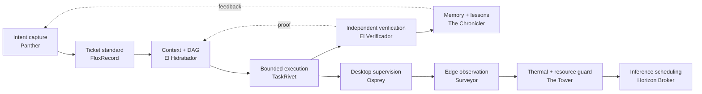

# Mike Hamanaka

## Building local-first software that can explain itself

I build developer tools, AI-agent infrastructure, and edge systems around one question: **can a person inspect what happened, understand why it happened, and decide what happens next?**

My projects are intentionally small, composable, and evidence-oriented. They capture intent, stage bounded work, verify results, observe the machine, and keep authority visible instead of hiding it behind automation.

**San Diego, California** · [Project atlas](https://hamanakam1.github.io/) · [EdgeRecord](https://edgerecord.com) · [@sjultra](https://sjultra.com)

> Less repeated context. More accepted work. Visible failures.

  

## The factory, at a glance

This is a **conceptual map**, not a claim that every repository is deployed as one production system. Each project README is the source of truth for its implemented interfaces, supported platforms, and maturity.

## Start here

| If you want to… | Open |
| --- | --- |
| See the visual project directory | [hamanakam1.github.io](https://hamanakam1.github.io/) |
| Capture a browser idea without silently executing it | [Panther Intent Capture](https://github.com/hamanakam1/panther-intent-capture) · [live site](https://hamanakam1.github.io/panther-intent-capture/) |
| Coordinate AI coding sessions | [TaskRivet](https://github.com/hamanakam1/taskrivet) · [live site](https://hamanakam1.github.io/taskrivet/) |
| Turn a plan into bounded execution state | [El Hidratador](https://github.com/hamanakam1/el-hidratador) |
| Check whether work is actually done | [El Verificador](https://github.com/hamanakam1/el-verificador) · [live site](https://hamanakam1.github.io/el-verificador/) |
| Understand local hardware and topology | [The Surveyor](https://github.com/hamanakam1/the-surveyor) · [live site](https://hamanakam1.github.io/the-surveyor/) |
| Explore the public demos | [Project atlas](https://hamanakam1.github.io/) |

## Public project gallery

### Capture, coordinate, verify

| Project | What it does | Visual / docs |
| --- | --- | --- |
| [Panther Intent Capture](https://github.com/hamanakam1/panther-intent-capture) | Local-first browser intent capture with visible controls, evidence-linked proposals, portable JSON, and opt-in ticket delivery. It creates tickets; it does not execute work. | [Open demo](https://hamanakam1.github.io/panther-intent-capture/) |
| [FluxRecord](https://github.com/hamanakam1/fluxrecord) | A ticket standard for evidence-driven coordination across agent sessions. | [Open demo](https://hamanakam1.github.io/fluxrecord/) |
| [El Hidratador](https://github.com/hamanakam1/el-hidratador) | Expands dry semantic tickets into reviewable context, ordered DAGs, and locked execution state. | [Open docs](https://hamanakam1.github.io/el-hidratador/) |
| [TaskRivet](https://github.com/hamanakam1/taskrivet) | A local-first workspace for persistent terminals, bounded ticket context, traceable progress, and reviewable results. | [Open demo](https://hamanakam1.github.io/taskrivet/) |
| [Osprey](https://github.com/hamanakam1/osprey) | A Swift/macOS supervisor for TaskRivet with work capture, stream redaction, and guarded releases. | [Source](https://github.com/hamanakam1/osprey) |
| [El Verificador](https://github.com/hamanakam1/el-verificador) | Independent intent checks, bounded retry loops, and proof-of-work records for reviewable AI coding workflows. | [Open docs](https://hamanakam1.github.io/el-verificador/) |

### Remember, observe, and protect the edge

| Project | What it does | Visual / docs |
| --- | --- | --- |
| [The Chronicler](https://github.com/hamanakam1/the-chronicler) | A local-first memory core that extracts failure heuristics with local Ollama and commits hardened rules back to Git. | [Open demo](https://hamanakam1.github.io/the-chronicler/) |
| [The Surveyor](https://github.com/hamanakam1/the-surveyor) | Read-only hardware discovery, topology snapshots, and change reports using Open Edge Topology. | [Open demo](https://hamanakam1.github.io/the-surveyor/) |
| [The Tower](https://github.com/hamanakam1/the-tower) | Prototype thermal, power, and memory monitoring with advisory dispatch defaults. | [Open demo](https://hamanakam1.github.io/the-tower/) |
| [Horizon Broker](https://github.com/hamanakam1/horizon-broker) | An alpha asynchronous inference queue with retries and failover for edge fleets. | [Open demo](https://hamanakam1.github.io/horizon-broker/) |
| [Mockmill](https://github.com/hamanakam1/mockmill) | Deterministic synthetic business stories and offline CRM fixtures for Salesforce, HubSpot, Dynamics, Zoho, and Pipedrive. | [Source](https://github.com/hamanakam1/mockmill) |
| [VortexMesh](https://github.com/hamanakam1/VortexMesh) | Go-based mesh and edge-systems exploration. | [Source](https://github.com/hamanakam1/VortexMesh) |

### Experiments and upstream collaborations

| Project | What it is |
| --- | --- |
| [Archify](https://github.com/hamanakam1/archify) | A forked agent skill for turning ideas, plans, and codebases into interactive diagrams. |
| [Docker Sandboxes workshop](https://github.com/hamanakam1/wad-sbx-workshop) | A forked workshop with a field guide and sandbox connectors for host-side testing. |

## The principles behind the code

- **Local first:** local inference, local ledgers, local Git, and no silent cloud fallback.
- **Visible authority:** every component says what it may do and what it may not do.
- **Evidence over adjectives:** a diff is not an intent; a finished session is not accepted work.
- **Read-only by default:** observation and proposals are safer starting points than dispatch.
- **Synthetic examples in public:** public fixtures and screenshots avoid real credentials, systems, and operational data.

## Private work index

GitHub only displays private repositories to people who already have access. For that reason, this section is an intentionally transparent index rather than a claim that private code is publicly browsable.

| Repository | Focus |
| --- | --- |
| [ai-dashboard](https://github.com/hamanakam1/ai-dashboard) | Operator console for agents, inference, tickets, spend, and the local machine. |
| [blessed-edge-deployment](https://github.com/hamanakam1/blessed-edge-deployment) | Deployment workbench for the edge stack. |
| [edgerecord-core](https://github.com/hamanakam1/edgerecord-core) | Rust append-only state verifier for edge nodes. |
| [edgerecord](https://github.com/hamanakam1/edgerecord) | Local-first verification and evidence workspace. |
| [edgerecord-ai](https://github.com/hamanakam1/edgerecord-ai) | Sovereign local AI workspace and durable handoff layer. |
| [edgerecord-com](https://github.com/hamanakam1/edgerecord-com) | Multi-tenant Joomla, Postgres, React, and TypeScript SaaS shell. |
| [edgerecord-era](https://github.com/hamanakam1/edgerecord-era) | Autonomy evidence and records ledger. |
| [edgerecord-publisher](https://github.com/hamanakam1/edgerecord-publisher) | Receipt publishing through Joomla Web Services. |
| [cofoundry](https://github.com/hamanakam1/cofoundry) | Local-model supervisor, dispatch, readiness gates, and audited control plane. |
| [portal](https://github.com/hamanakam1/portal) | Private personal clone of Portal. |
| [onramp-synthetic-company](https://github.com/hamanakam1/onramp-synthetic-company) | Synthetic company and onboarding fixtures. |
| [VS Platform synthetic fleet](https://github.com/hamanakam1/vs-platform-synthetic-fleet) | Synthetic hardware fleet and protocol fixtures. |
| [CloudTeams experiments](https://github.com/hamanakam1/cloudteams-extension-studio) | Private extension and workflow experiments: `extension-studio`, `lunch-break`, and `plot-twist`. |

## About screenshots and animated demos

The project atlas is the current visual front door. The next visual pass should add one **synthetic** screenshot or short GIF per public application, captured from a clean demo state and stored in the relevant repository or Pages site. GIFs are appropriate for short UI loops; screenshots are better for architecture, settings, and accessibility details. No screenshot should contain credentials, private logs, real customer data, or machine-identifying information.

## Working with me

I’m interested in thoughtful collaboration around local-first agents, evidence-driven developer tools, edge computing, verification, and humane operator experiences. The best starting point is a focused issue with a reproducible example, an explicit scope, and a clear distinction between observed behavior and proposed behavior.

Most public repositories are MIT licensed; check each repository for its exact license and contribution guidance.
